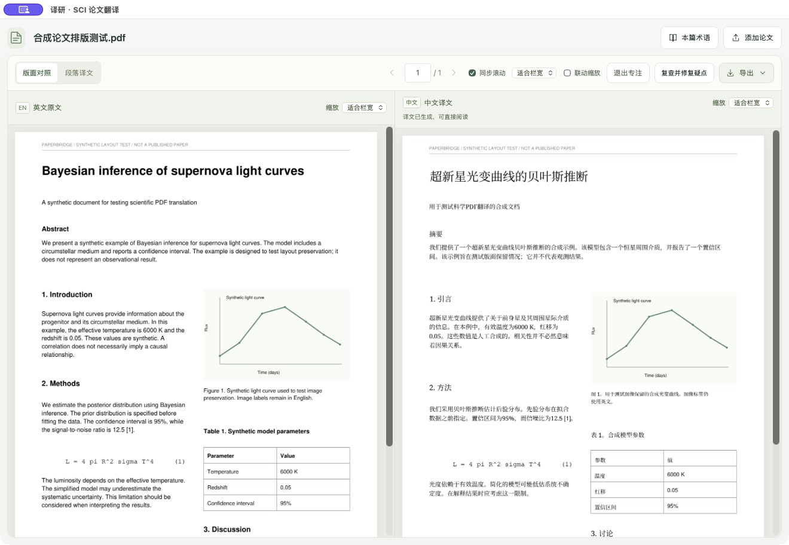
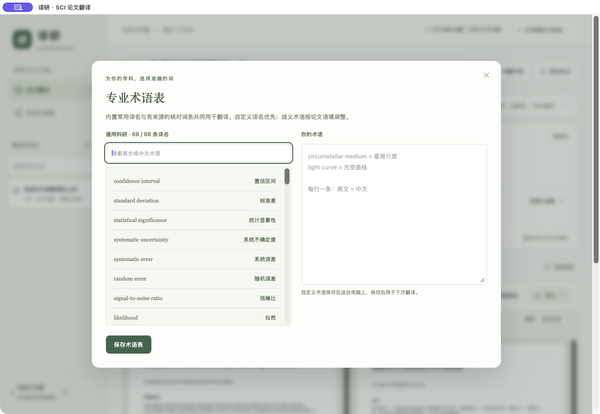
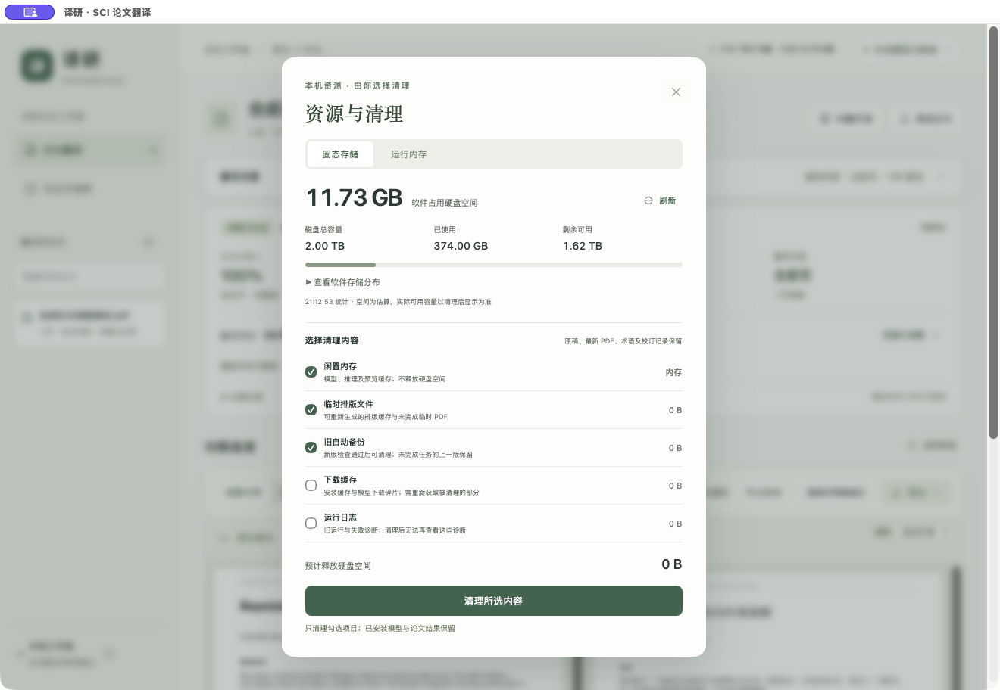

# 译研 Mac 安装与使用教程

从下载到第一次翻译，按下面的步骤操作即可。

**[前往完整离线版下载页](https://github.com/hengyuwu-dot/yiyan-paperbridge/releases/tag/v1.4.0-offline-14b)** · **[返回软件首页](../README.md)**

## 1. 查看 Mac 配置

点击屏幕左上角的苹果菜单 → **关于本机**，查看芯片和系统版本。

| 项目 | 配置 |
| --- | --- |
| 芯片 | Apple Silicon，M 系列 Mac |
| 系统 | macOS 26.2 或更新版本 |
| 内存 | 使用 14B 精译建议 24GB 或更多统一内存 |
| 硬盘 | 安装时建议有 35GB 可用空间 |

完整离线版约 9.50GB，内含 14B、4B 模型、排版资源、字体及 Python 运行环境。

## 2. 下载 7 个文件

打开下载页，找到 **Assets**，下载下面的 6 个分卷和 1 个合并工具：

```text
Yiyan-1.4.0-AppleSilicon-Offline-14B.tar.gz.part001
Yiyan-1.4.0-AppleSilicon-Offline-14B.tar.gz.part002
Yiyan-1.4.0-AppleSilicon-Offline-14B.tar.gz.part003
Yiyan-1.4.0-AppleSilicon-Offline-14B.tar.gz.part004
Yiyan-1.4.0-AppleSilicon-Offline-14B.tar.gz.part005
Yiyan-1.4.0-AppleSilicon-Offline-14B.tar.gz.part006
Full-Mac-Merge-Tools.zip
```

下载页前 5 个分卷各显示约 1.76GB，第 6 个显示约 58.5MB。下载完成后，按文件名确认编号从 `001` 连续到 `006`。

`Source code` 是开发源码；安装应用时选择上面列出的 7 个文件。

## 3. 合并完整应用

1. 在 Finder 的“下载”文件夹中，双击 `Full-Mac-Merge-Tools.zip`。
2. 打开解压得到的 **合并工具** 文件夹。
3. 将下载好的 6 个 `.partNNN` 分卷拖入这个文件夹。

文件夹中应包含：

```text
合并工具/
├── 合并完整应用.command
├── MAC-PARTS.json
├── MAC-PARTS-SHA256.txt
├── Yiyan-1.4.0-AppleSilicon-Offline-14B.tar.gz.part001
├── Yiyan-1.4.0-AppleSilicon-Offline-14B.tar.gz.part002
├── Yiyan-1.4.0-AppleSilicon-Offline-14B.tar.gz.part003
├── Yiyan-1.4.0-AppleSilicon-Offline-14B.tar.gz.part004
├── Yiyan-1.4.0-AppleSilicon-Offline-14B.tar.gz.part005
└── Yiyan-1.4.0-AppleSilicon-Offline-14B.tar.gz.part006
```

4. 双击 **合并完整应用.command**。
5. 合并工具会打开终端窗口，逐卷检查 SHA256，再合并并校验完整文件。等待工具完成；生成的完整归档会自动打开。

合并后的文件名是：

```text
Yiyan-1.4.0-AppleSilicon-Offline-14B.tar.gz
```

## 4. 安装并打开译研

1. 双击完整 `.tar.gz` 文件，等待 macOS 解压。
2. 找到 **译研.app**，将它拖入 Finder 左侧的 **应用程序**。
3. 打开“应用程序”，双击 **译研**。
4. 等待首页加载，右上角显示 **本地模型已就绪** 后，即可导入论文。

首次打开合并工具或应用时，按 macOS 提示确认运行。若系统显示“无法验证开发者”等来源确认提示，确认文件来自本仓库、合并校验通过后，可在 **系统设置 → 隐私与安全性 → 安全性 → 仍要打开** 中完成确认，再点击“打开”。操作依据：[Apple 的 Mac App 打开说明](https://support.apple.com/zh-cn/102445)。


## 5. 翻译第一篇论文

1. 点击首页 **选择论文 PDF**，选择英文科研论文；也可以将 PDF 拖入窗口。
2. 展开 **翻译设置**，选择论文领域：通用科研、天文与物理、医学与生命科学、材料与化学、工程与计算机。
3. 选择翻译范围。翻译整篇时保持“全部页”，翻译指定页时填写 `1-3,5` 等页码。
4. 在 **更多设置 → 本地模型** 中选择 **精译 · 14B** 或 **标准 · 4B**，按需开启译后复核与润色。
5. 点击 **开始翻译**。完成后，工作台会显示翻译用时和译稿大小。

适用文件：正文可以选中、复制的英文 PDF。单篇支持 80MB 以内、300 页以内；一次导入多篇时，软件会按队列依次处理。

## 6. 阅读、缩放与导出



- **一起翻阅**：左侧英文、右侧中文，使用页码框、翻页按钮或键盘左右方向键切换页面。
- **同步滚动**：勾选“同步滚动”，原文与译文一起滚动。
- **两侧放大**：分别使用两栏上方的缩放菜单；勾选“联动缩放”后，两侧按相同比例缩放。
- **专注阅读**：点击“专注阅读”扩大论文阅读区域，按 `Esc` 返回工作台。
- **修改译文**：切换到“段落译文”，修改中文后保存，软件会更新 PDF。
- **导出文件**：点击“导出”，选择“中文 PDF（原页数）”“双语 PDF（原译交替）”或“完整译文与核对记录”。

## 7. 让专业译名符合你的习惯

点击侧栏 **专业术语表**，搜索已有词条，在右侧按“英文 = 中文”的格式输入自定义术语，然后点击 **保存术语表**。

```text
circumstellar medium = 星周介质
progenitor = 前身星
light curve = 光变曲线
```

论文页面顶部的 **本篇术语** 用于当前论文。更新术语后，可开始翻译，或点击 **复查并修复疑点** 重新处理相关译文。



## 8. 查看资源和管理空间

点击右上角 **内存 / 存储**，打开“资源与清理”。

- 在 **固态存储** 中查看软件占用、磁盘容量和剩余空间。
- 在 **运行内存** 中查看翻译服务的内存占用。
- 勾选需要处理的类别，点击 **清理所选内容**。
- 在翻译设置中开启 **完成后自动清理**，任务结束后自动整理临时文件和旧自动备份，并释放模型内存。



日常翻译从“应用程序”打开译研即可。论文工作室的数据目录为 `~/Library/Application Support/PaperBridge-Offline/`。

## 常见操作问题

| 遇到的情况 | 处理方法 |
| --- | --- |
| 下载页一开始只显示部分附件 | 点击 **Show all assets**，展开全部附件。 |
| 合并工具提示找不到分卷 | 将 `001` 到 `006` 全部放入“合并工具”文件夹，核对完整文件名；重复下载产生的 `(1)` 后缀需整理为原文件名。 |
| 某个分卷校验未通过 | 根据提示重新下载对应编号的分卷，再运行合并工具。 |
| Finder 将文件解压到了另一个文件夹 | 打开解压位置，找到“译研.app”，再拖入“应用程序”。 |
| 想减少翻译时的内存占用 | 在“更多设置”中选择 **标准 · 4B**，或翻译指定页面。 |

**[返回软件首页](../README.md)** · **[下载完整离线版](https://github.com/hengyuwu-dot/yiyan-paperbridge/releases/tag/v1.4.0-offline-14b)**
